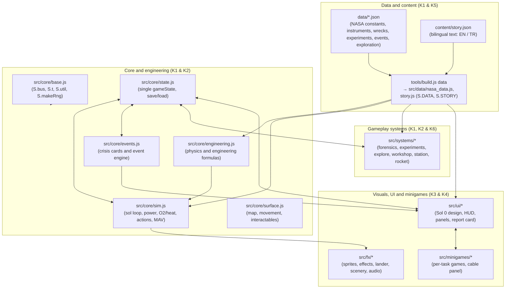

# ARCHITECTURE.md — Technical Architecture, Folder Layout and Asset Pipeline

This document describes the runtime architecture of **SOL 14: RED HORIZON**, its folder layout, the central `gameState` flow and how images get from `assets/` into the game.

---

## 1. Overview

The game is **vanilla JavaScript (classic `<script>` files) + HTML5 Canvas 2D + a DOM/CSS UI**. There is no framework, no bundler and no runtime dependency, so it runs from any static server and also by double-clicking `index.html` (`file://`).

- **No ES modules:** every file is an IIFE on one namespace, `(function (S) { ... })(window.SOL14 = window.SOL14 || {})`. `import`/`export`, `fetch` and runtime `getImageData` are not used because they fail under `file://`.
- **Script order matters:** the order in `index.html` matches the `CORE_SCRIPTS` list in `tests/helpers/load_core.js`. Core and systems files never touch the DOM, so the tests run them headless in a Node `vm` context.
- **Build step for data and images:** `tools/build.js` turns the JSON data and the source images into files the game loads directly (see §4).



Modules talk through the shared state and the event bus (`S.bus.emit` / `S.bus.on`); the simulation never calls the drawing code directly.

---

## 2. Folder layout

```text
nasa_space_apps_hackathon_26/
├── index.html                 # Entry page: canvas + UI layers, script order
├── package.json               # npm test / npm start
├── styles/                    # main.css (UI, HUD, cards), fonts.css (embedded VT323)
├── data/                      # nasa_data.json, forensics_cases.json, experiments_config.json,
│                              # events_catalog.json, explore_config.json (every number has a src)
├── content/story.json         # All player-facing text, EN and TR
├── tools/                     # build.js (data + assets), png.js / gif.js (image codecs)
├── src/
│   ├── main.js                # Scene flow: loading → menu → design → transit → world → ending → report
│   ├── data/                  # GENERATED by tools/build.js: never edit by hand
│   ├── core/                  # base, engineering, state, sim, events, score, objectives, surface
│   ├── systems/               # forensics, experiments, explore, workshop, station, rocket
│   ├── ui/                    # design screens, HUD, hotbar, panels, cutscenes, report card
│   ├── minigames/             # minigames.js (router) + task_games.js (per-task games)
│   └── fx/                    # sprites, effects, art, lander, opening, dig/station/west scenery, audio
├── assets/                    # Source art and audio (build input)
│   └── processed/             # GENERATED by tools/build.js: what the game loads
└── tests/                     # node --test suites + helpers (load_core.js, bot.js)
```

---

## 3. State and flow

- `src/core/state.js` holds the single `gameState`. Fields added after a release are filled for old saves by `S.ensureExploreState` (called on load, checkpoint, `enterWorld` and landing).
- `src/core/sim.js` advances game time (`Sim.advance`), runs the sol rollover and all base actions; formulas live only in `engineering.js`.
- `src/main.js` owns the scene flow and input, and queues what happens after an action (`Game.afterAction` → sol transition, impact card, crisis card, end of mission).
- Internal canvas resolution is **640×360**; full-screen scenes are 960×540. `S.Surface.mToPx` / `pxToM` map metres to pixels piecewise (the base area is drawn at sprite scale).

---

## 4. Asset pipeline

`node tools/build.js assets` reads `assets/**` and writes `assets/processed/**` plus `manifest.json`:

1. **Chroma key at build time:** isolated sprites and structures were drawn on pure white (`#FFFFFF`). The build removes the outer white with an edge flood fill, so the white spacesuit and habitat walls inside the outline stay intact.
2. **Crop and downscale:** each image is cropped to its content and scaled to the size set in the `ASSETS` manifest in `tools/build.js` (pixel-art sizes, nearest neighbour).
3. **Full-screen scenes** are scaled to 960×540. JPEG scenes (mission prep previews, shuttle interiors) are copied as 1600 px files into both `assets/screens/` and `assets/processed/screens/`.

The game never processes pixels at runtime. `S.Sprites.get(key)` returns a loaded image; `S.Sprites.screen(key)` returns an absolute URL for CSS backgrounds (`--bg:url(...)`).

Sources, licences and AI use for every asset are listed in [REFERENCES.md](REFERENCES.md).
