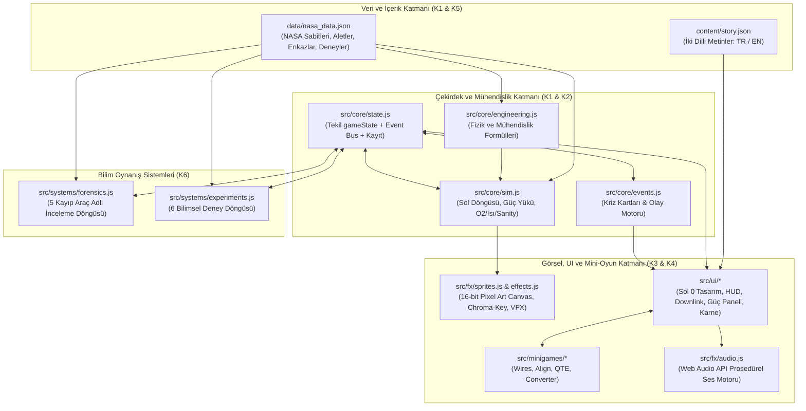

# ARCHITECTURE.md — Teknik Mimari, Klasör Yapısı ve Varlık Eşlemesi

Bu belge, **SOL 14: RED HORIZON** projesinin çalışma zamanı mimarisini, dizin yapısını, merkezi `gameState` akışını ve kök dizindeki 32 görsel varlığın (`PNG`) oyun içi `assets/` yapısına eşlemesini açıklar.

---

## 1. Üst Düzey Mimari Genel Bakış

Proje, dış bağımlılık kırılganlığı olmadan her tarayıcıda ve yerel sunucuda anında çalışabilen **Vanilla JavaScript (ES Modules) + HTML5 Canvas 2D + Modüler DOM/CSS UI** mimarisi üzerine kurulmuştur.



---

## 2. Dizin ve Dosya Yapısı

```text
sol14-red-horizon/
├── index.html                      # Ana giriş sayfası (Canvas + UI katmanları)
├── package.json                    # Test ve yerel sunucu betikleri
├── styles/
│   └── main.css                    # 16-bit retro sci-fi UI, HUD, kart ve animasyon stilleri
├── data/
│   └── nasa_data.json              # Doğrulanmış NASA verileri (src URL'leri ile)
├── content/
│   └── story.json                  # TR ve EN iki dilli tüm oyun metinleri
├── src/
│   ├── main.js                     # Uygulama başlatıcı, ekran yönlendirici, ?demo kontrolü
│   ├── core/
│   │   ├── engineering.js          # Güneş gücü, Δv, ışık gecikmesi, sarkaç, O2, GBP formülleri
│   │   ├── state.js                # Merkezi gameState, Event Bus (on/emit), localStorage, t()
│   │   ├── sim.js                  # Gündüz/gece, güç yükü (M3), dönüşsüzlük noktası (M4), Sol geçişi
│   │   └── events.js               # 15 zorluk/olay kataloğu, Kriz Kartı (M2), Görev Kontrol (M7)
│   ├── systems/
│   │   ├── forensics.js            # 5 kayıp araç adli inceleme (kanıt -> teşhis -> NASA bulgusu)
│   │   └── experiments.js          # 6 deney (hipotez -> ortam -> kontrol -> ölçüm -> ödül)
│   ├── ui/
│   │   ├── design_screens.js       # Sol 0: 5 aşamalı görev tasarım ekranı + SPOF uyarısı (M8)
│   │   ├── hud.js                  # Yüzey HUD çubukları, keşif haritası, laboratuvar ve aksiyonlar
│   │   ├── downlink.js             # Veri bütçesi ve Downlink kuyruğu paneli (M1)
│   │   ├── power_panel.js          # Güç yük önceliklendirme (Load Shedding) paneli (M3)
│   │   ├── decision_card.js        # Kriz karar kartı modalı (M2) + Gecikmeli Görev Kontrol (M7)
│   │   └── report_card.js          # Neden-Sonuç Karnesi (M5) + UFO Stinger final sahnesi
│   ├── minigames/
│   │   └── minigames.js            # 4 yeniden kullanılabilir şablon: Wires, Align, QTE, Converter
│   └── fx/
│       ├── sprites.js              # Görsel yükleyici, #FFFFFF beyaz arka plan şeffaflaştırıcı (Chroma-Key)
│       ├── effects.js              # Parallax yüzey, 0.38g astronot, fırtına, buz, UFO satır-satır foto
│       └── audio.js                # Web Audio API tabanlı ses sentezleyici (rüzgâr, alarm, radar, UFO)
├── assets/
│   ├── backgrounds/                # 16:9 Mars yüzey arka planları (6 adet)
│   ├── sprites/                    # 1:1 Astronot, drone ve enkaz sprite'ları (10+ adet)
│   ├── structures/                 # Üs yapıları: Habitat, MAV, Sera, Güneş Paneli, MOXIE (6+ adet)
│   ├── screens/                    # 16:9 Tam ekran panel arka planları (7 adet)
│   ├── vfx/                        # Vizör buzu, fırtına, toz şeytanı, halüsinasyon (5 adet)
│   └── ending/                     # UFO kalkış, gökyüzü, net/bulanık foto ve kapak görseli (6 adet)
└── tests/
    └── engineering.test.js         # node --test ile çalışan mühendislik ve simülasyon testleri
```

---

## 3. Görsel Varlık (Asset) Eşleme Tablosu

Kök dizinde bulunan **32 adet üretilmiş PNG görseli**, `docs/design/ai-image-prompts.md` içindeki standart dosya adlarına aşağıdaki şekilde eşlenir:

| Kök Dizindeki Mevcut Dosya Adı | Hedef `assets/` Yolu | Açıklama / Kullanım Yeri |
| :--- | :--- | :--- |
| `Mars'ta Kızıl Toz Fırtınası-1.png` | `assets/backgrounds/bg_storm.png` | Büyük Kum Fırtınası arka planı (16:9) |
| `Meridiani’nin kızıl ufku-2.png` | `assets/backgrounds/bg_meridiani_day.png` | Meridiani Planum (Ekvator) gündüz arka planı |
| `Mars'ta Buzlu Arcadia Ovası-3.png` | `assets/backgrounds/bg_arcadia_day.png` | Arcadia Planitia (Buzlu Orta Enlem) arka planı |
| `Kızıl Ufukta Yalnız Astronot-35.png` | `assets/backgrounds/bg_jezero_day.png` | Jezero Krateri gündüz / ana menü arka planı |
| `Mars sığınağında kızıl gün batımı-24.png` | `assets/backgrounds/bg_jezero_sunset.png` | Mars gün batımı / alacakaranlık arka planı |
| `Küçük Aylar Altında Piksel Astronotu-36.png` | `assets/backgrounds/bg_jezero_night.png` | Yıldızlı Mars gecesi ve Phobos/Deimos |
| `Mars'ta yürüyen 16-bit astronot-4.png` | `assets/sprites/astronaut_walk.png` | Astronot yürüme sprite'ı (`#FFFFFF` zemin) |
| `Mars astronotu düşük yerçekiminde sıçrıyor-5.png` | `assets/sprites/astronaut_jump.png` | 0.38g düşük yerçekimi zıplama sprite'ı |
| `Buz tutmuş Mars astronotu-6.png` | `assets/sprites/astronaut_frozen.png` | -80°C donmuş eklemlerle yürüyen astronot |
| `Diz çöken Mars astronotu tamir ediyor-7.png` | `assets/sprites/astronaut_action.png` | Tamir / numune / inceleme yapan astronot |
| `16-bit Mars Ingenuity helikopteri-8.png` | `assets/sprites/drone_ingenuity.png` | Ingenuity keşif drone'u sprite'ı |
| `Kumlara gömülü Spirit Mars gezgini-9.png` | `assets/sprites/rover_spirit.png` | Spirit (ve Opportunity) gezgin enkazı |
| `Donmuş Phoenix Mars Landeri-10.png` | `assets/sprites/lander_phoenix.png` | Phoenix enkazı (kırık panel & CO2 buzu) |
| `Kızıl tozda InSight iniş aracı-11.png` | `assets/sprites/lander_insight.png` | InSight enkazı + SEIS sismometresi |
| `Terk edilmiş Beagle 2 iniş aracı-12.png` | `assets/sprites/lander_beagle2.png` | Beagle 2 bonus enkazı |
| `16-bit Mars yükseliş aracı-13.png` | `assets/structures/mav_rocket.png` | Mars Yükselme Aracı (MAV) |
| `Basınçlı Mars sera kubbesi-14.png` | `assets/structures/greenhouse_ok.png` | Sağlıklı basınçlı sera kubbesi |
| `Buz tutmuş Mars serası-15.png` | `assets/structures/greenhouse_frozen.png` | Donmuş / hasarlı sera kubbesi |
| `Mars’ın üçlü güneş paneli dizisi-16.png` | `assets/structures/solar_clean.png` | Temiz üçlü güneş paneli dizisi |
| `Tozla Kaplı Üç Mars Güneş Paneli-17.png` | `assets/structures/solar_dusty.png` | Tozla kaplı üçlü güneş paneli dizisi |
| `Moxie ve RTG güç ünitesi-18.png` | `assets/structures/moxie_unit.png` | MOXIE oksijen üretici ve RTG güç ünitesi |
| `Alacakaranlıkta roket fırlatması-19.png` | `assets/screens/scr_launch.png` | Sol 00 Fırlatma sahnesi ekranı |
| `Mars'a Doğru Yıldızlararası Yolculuk-20.png` | `assets/screens/scr_transit.png` | Sol 01–03 Uzay yolculuğu ekranı |
| `Jezero Krateri Mars keşif koridoru-21.png` | `assets/screens/scr_map_corridor.png` | Keşif koridoru taktik harita zemini |
| `Mars habitatında bilim masası-22.png` | `assets/screens/scr_lab_desk.png` | Habitat içi bilim laboratuvarı ve sarkaç masası |
| `Mars İletişim İstasyonunda Kızıl Ufuk-23.png` | `assets/screens/scr_downlink.png` | Downlink haberleşme konsolu ekranı |
| `Kızıl ufukta mavi güneş ve Phobos-25.png` | `assets/screens/scr_sol_transition.png` | Mavi gün batımı ve Sol geçiş ekranı |
| `Buz kristalli piksel çerçevesi-26.png` | `assets/vfx/vfx_frost_1.png` | Hafif vizör buzlanması efekti |
| `Yoğun buzla çevrili vizör açıklığı-27.png` | `assets/vfx/vfx_frost_2.png` | Kritik vizör buzlanması efekti |
| `Rüzgârda Savrulan Mars Tozu-28.png` | `assets/vfx/vfx_dust_storm.png` | Kum fırtınası parçacık perdesi |
| `16-bit Mars kum şeytanı-29.png` | `assets/vfx/vfx_dust_devil.png` | Toz şeytanı (Dust Devil) mini hortumu |
| `Beyaz fonda glitchli astronot silüeti-30.png` | `assets/vfx/vfx_shadow_hallucination.png` | Akıl sağlığı gölge halüsinasyonu |
| `Kızıl Mars'tan Roket Kalkışı-31.png` | `assets/ending/ufo_liftoff.png` | Sol 14 MAV kalkış sahnesi |
| `Mars Göğünde Roket ve Gizemli Işık-32.png` | `assets/ending/ufo_sky.png` | Ufuktaki gizemli UFO ışığı ve MAV |
| `Mars atmosferinde gizemli üçgen disk-33.png` | `assets/ending/ufo_photo_clear.png` | UFO fotoğrafı — `%80` Net versiyon |
| `Parazitli UFO ışık izi-34.png` | `assets/ending/ufo_photo_blur.png` | UFO fotoğrafı — `%30` Bulanık versiyon |

*(Not: Prompt kütüphanesinde "Tamamlandı" olarak işaretlenen `astronaut_idle.png`, `rover_opportunity.png`, `habitat_main.png` ve `scr_habitat_cutaway.png` için mevcut sprite/ekran görselleri veya Canvas çizim yedekleri otomatik bağlanır.)*

---

## 4. Beyaz Arka Plan Şeffaflaştırma (Chroma-Key Pipeline)

`assets/sprites/`, `assets/structures/` ve `assets/vfx/` altındaki izole varlıklar `#FFFFFF` saf beyaz zemin üzerine üretilmiştir. `src/fx/sprites.js` içindeki `loadTransparentSprite(url, threshold = 240)` fonksiyonu:
1. Görseli bellek içi (offscreen) bir `<canvas>` nesnesine çizer.
2. `getImageData` ile pikselleri tarar ve `R > 240 && G > 240 && B > 240` (köşelerden başlayan flood-fill veya renk eşiği) olan beyaz zemin piksellerinin `Alpha` değerini `0` yapar.
3. Astronotun beyaz EVA kıyafetinin iç kısımlarının silinmemesi için **kenarlardan içe doğru Flood-Fill (Sınır Doldurma)** algoritması kullanır; böylece dış beyaz arka plan tamamen şeffaf olurken astronotun beyaz uzay giysisi ve beyaz habitat duvarları %100 korunur!
